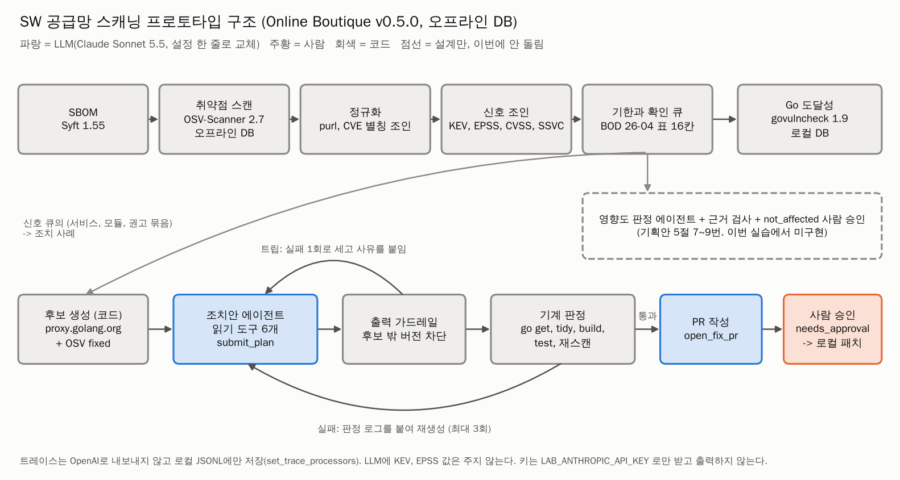

# SW 공급망 스캐닝 AI 에이전트: 사전 프로토타입

롯데 AX 챌린지 2026 롯데이노베이트 [인프라] 과제의 사전 프로토타입입니다. SBOM과 취약점 스캔 결과를 **영향도, 우선순위, 조치안**으로 잇는 AI 에이전트를 공개 앱 Google Online Boutique에 적용하고, 모든 수치를 이 저장소의 코드로 다시 돌릴 수 있게 남겼습니다.

- 대상: Online Boutique v0.5.0(2022-12, 오래 고치지 않은 시스템), 대조군 main(2026-10)
- 도구: Syft, OSV-Scanner(오프라인), govulncheck, CISA KEV, FIRST EPSS, CycloneDX VEX, OpenAI Agents SDK
- 상세 결과: [lotte/innovate/RESULTS.md](lotte/innovate/RESULTS.md)

## 핵심 수치

| 항목 | 결과 |
|---|---|
| 스캔 깔때기 (v0.5.0) | 구성요소 823개, 보고 545행 -> 신호 큐 37행(프런트엔드만 공개 가정) -> Go 호출 경로 14행 |
| 기한 분포 | 3일, 14일 기한 행: 전부 내부 9, 프런트엔드만 공개 34, 전부 공개 376. 자산 정보가 기한을 정하는 핵심 입력 |
| 우선순위 백테스트 | KEV 시점 분리 3개 창, 상위 1,000건에서 EPSS 순 6, 2, 3건 대 CVSS 순 약 1, 0, 1건 |
| 조치안 구조 비교 | 평가 사례 10건에서 에이전트, LLM 1회 호출, LLM 없는 최소 수정 모두 6건이 기계 판정(빌드, 테스트, 재스캔) 통과. 건당 $0.066 대 $0.028 -> 고정 흐름으로 확정 |
| 재스캔 게이트 | 빌드와 테스트를 통과한 LLM 제안 조합 4개(시도 6회)가 끌어온 새 고위험 권고 12묶음을 6회 모두 차단 |
| 영향도 판정 에이전트 | VEX-Bench Go 8건 x 3회: 놓침 0, 잘못 지움 0, not_affected 정답 5건 중 4, 3, 4건 ('항상 exploitable' 기준선 0건) |

## 구조



- 코드가 후보 생성, 신호 조인, 기한 계산, 조치안 판정을 결정하고, LLM은 영향도 판정, 코드가 준 후보 안의 조치안 작성, PR 제목에 씁니다.
- PR 생성은 사람 승인 단계(needs_approval)를 거칩니다. 위험 판정을 낮추는 not_affected는 사람 승인으로 보내도록 설계했습니다(기획안 5절).
- 모델은 설정 한 줄(`LAB_MODEL`)로 바꿉니다. 사전 실측은 Claude Sonnet 5.5(승격 4건은 Opus 5.5)로 했고, 본선 전 같은 코드로 OpenAI 모델을 돌립니다.

## 확인 방법

```bash
git clone https://github.com/khj1212k/supply-chain-scan-agent
cd supply-chain-scan-agent
git checkout lotte-innovate-public && cd lotte/innovate
# 준비와 모듈별 실행 명령: lotte/innovate/README.md '어떻게 돌리나'
```

| 모듈 | 폴더 | 결과 |
|---|---|---|
| M1 우선순위 백테스트 | `lotte/innovate/m1/` | `lotte/innovate/results/m1/` |
| M2 스캔 깔때기 | `lotte/innovate/m2/` | `lotte/innovate/results/m2/` |
| 도달성 (govulncheck) | `lotte/innovate/reach/` | `lotte/innovate/results/reach/` |
| 조치안 에이전트 | `lotte/innovate/agent/` | `lotte/innovate/results/agent/` |
| 영향도 판정 에이전트 | `lotte/innovate/vexpilot/` | `lotte/innovate/results/vexpilot/` |

문서: [RESULTS](lotte/innovate/RESULTS.md), [DECISIONS](lotte/innovate/DECISIONS.md), [DATA](lotte/innovate/DATA.md), 모듈별 NOTES(`m2/`, `reach/`, `agent/`, `vexpilot/`), 실행 전에 고정한 평가 규칙(`agent/CASES_RULE.md`, `vexpilot/CASES_RULE.md`)

## 수치 동결

- 태그 `lotte-innovate-freeze`: 커밋 f1792a5, 2026-11-02 23:39 KST. 이 시점에 결과 수치를 고정했습니다.
- 태그 `lotte-innovate-public`: 공개용 문서를 정리한 판입니다. 결과 파일은 동결 태그와 같습니다.

```bash
git diff lotte-innovate-freeze lotte-innovate-public -- lotte/innovate/results lotte/innovate/data   # 출력 없음
```

- 이 저장소는 2026-11-04에 작업 저장소에서 결과 증빙(코드, 결과 파일, 결과 문서)을 옮긴 공개본입니다. 커밋 날짜, 작성자, 결과 파일과 데이터는 바이트 단위로 그대로이고, 문서 속 작업 메모(작업 지시와 내부 파일 참조)는 공개본에서 정리했습니다. 문서와 결과 파일에 적힌 7자리 커밋 번호는 [COMMIT_MAP.md](COMMIT_MAP.md)로 이 저장소의 커밋과 대응합니다.

## 만든 방식

- 설계 기준, 판정 규칙, 합격선: 김형준
- 구현과 실행: 김형준이 AI 코딩 에이전트(Claude Code)를 지휘해 진행했습니다. 작성자가 Claude인 커밋은 에이전트가 만든 커밋입니다.
- 모듈별 하위 에이전트가 낸 숫자는 리드 세션이 서로 대조했고, M1은 새 컨테이너에서 처음부터 다시 돌려 결과 파일이 바이트 단위로 같음을 확인했습니다.

## 보안

- API 키는 환경 변수 `LAB_ANTHROPIC_API_KEY`로만 받고 출력하지 않습니다.
- 에이전트 트레이스는 외부로 보내지 않고 로컬 JSONL에만 씁니다.
- 원자료(`data/raw/`)는 커밋하지 않았습니다. 받은 URL, 시각, sha256은 `lotte/innovate/data/manifest*.json`에 있습니다.

## 데이터 출처와 라이선스

외부 데이터와 코드의 출처, 라이선스, 표기는 [THIRD_PARTY_NOTICES.md](THIRD_PARTY_NOTICES.md)에 있습니다.
