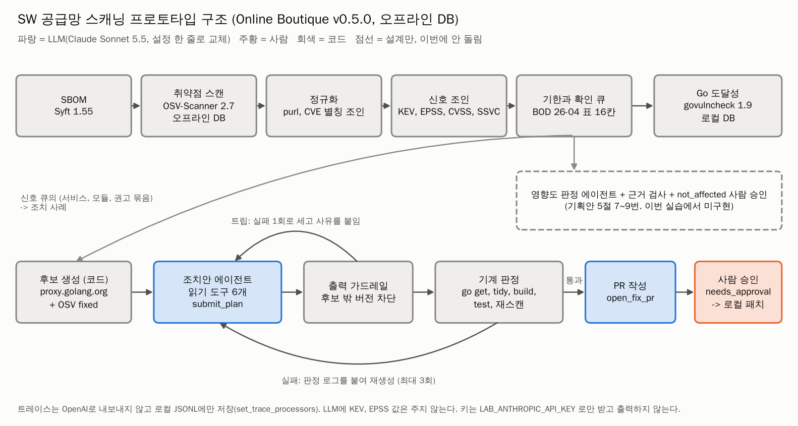

# lotte/innovate: SW 공급망 스캐닝 AI 에이전트 사전 프로토타입

롯데 AX 챌린지 롯데이노베이트 과제 예선용. 기획안의 예비 결과를 **도구로 다시 돌리고**, 조치안 에이전트와 영향도 판정 에이전트를 **Claude로 실측**한 사전 프로토타입이다.

- 결과와 수치: [RESULTS.md](RESULTS.md)
- 설계 결정과 근거: [DECISIONS.md](DECISIONS.md) / 데이터 출처: [DATA.md](DATA.md)
- 수치 동결: 2026-11-02 23:39 KST(태그 lotte-innovate-freeze). 그 뒤에는 문서만 고쳤다. 결과 파일 동일 확인: `git diff lotte-innovate-freeze lotte-innovate-public -- lotte/innovate/results lotte/innovate/data` (출력 없음)

## 무엇을 했나
| 모듈 | 질문 | 방법 | 폴더 |
|---|---|---|---|
| M1 우선순위 | 시점 T의 EPSS, CVSS 순위가 이후 90일의 KEV 추가를 얼마나 맞히나 | KEV 시점 분리 백테스트 3창. 같은 작업량 비교 | `m1/`, `results/m1/` |
| M2 연결 | 공개 앱의 스캔 결과가 패키지 -> 권고 -> CVE -> 신호 -> 기한 -> 확인 큐로 얼마나 줄어드나 | Syft SBOM, OSV-Scanner 오프라인, CVE 조인, KEV, EPSS, SSVC, BOD 26-04 표 | `m2/`, `results/m2/` |
| 도달성 | Go 서비스가 취약 함수를 실제로 부르나 | govulncheck 1.9.0, OSV 덤프로 만든 로컬 DB, 네트워크 끈 상태 | `reach/`, `results/reach/` |
| 조치안 에이전트 | 에이전트, LLM 1회 호출, LLM 없는 최소 수정 중 어느 구조가 기계 판정(빌드, 테스트, 재스캔) 통과와 비용에서 나은가 | OpenAI Agents SDK + Claude Sonnet 5.5. 평가 사례 10건, 기준선 4개, 고정 흐름 1개 | `agent/`, `results/agent/` |
| 영향도 판정 시범 | LLM 에이전트가 놓침 없이 not_affected를 가려내나 (CycloneDX VEX 상태) | VEX-Bench Go 8건 x 3회, 코드 근거 검사 | `vexpilot/`, `results/vexpilot/` |

대상 앱: Google Online Boutique (공개 마이크로서비스 데모). v0.5.0(2022-12)을 '오래 안 고친 시스템'으로, main(2026-10)을 대조로 썼다.

## 왜
- 스캐너는 건수를 낸다. 담당자는 '어느 서비스의 무엇을 언제까지, 어떻게 고치나'를 정해야 한다
- 이 과제의 핵심을 SBOM 생성이 아니라 **스캔 결과를 영향도, 우선순위, 조치로 잇는 연결**로 봤다(기획안 1~2절)
- 도구로 다시 돌려 근거를 댈 수 있는 숫자를, 판정이 걸러낸 조합까지 기록으로 남긴다 (설계 기준과 판정 규칙은 김형준, 구현과 실행은 김형준이 지휘한 AI 코딩 에이전트)

## 구조

- LLM 자리(파랑)는 조치안 작성과 PR 제목(본문과 패치는 코드) 두 곳이다. 나머지는 코드가 결정한다. 영향도 판정 에이전트(점선)는 VEX-Bench Go 8건 x 3회로 따로 평가했다(`vexpilot/`)
- 모델은 설정 한 줄(`LAB_MODEL`)로 바꾼다: `anthropic:claude-sonnet-5-5`(기본), `openai:gpt-6-luna`, `local:<이름>@<URL>`. 사전 실측은 Claude Sonnet 5.5(승격 4건은 Opus 5.5)로 했고, 본선 전 같은 코드로 OpenAI 모델을 돌린다

## 어떻게 돌리나
준비 (키 없이 약 10분)
```bash
cd lotte/innovate
uv venv --python 3.12 .venv && uv pip install --python .venv/bin/python "openai-agents[litellm]==0.24.0" pandas numpy matplotlib pydantic pytest
export GOPATH=/home/user/tools/gopath GOBIN=/home/user/tools/bin GOTOOLCHAIN=auto
go install github.com/google/osv-scanner/v2/cmd/osv-scanner@v2.7.0
go install github.com/anchore/syft/cmd/syft@v1.55.0
go install golang.org/x/vuln/cmd/govulncheck@v1.9.0
git clone https://github.com/GoogleCloudPlatform/microservices-demo.git /home/user/work/ob_repo
for x in v0.5.0:3c0d6597809d1f40dccd24b757b7ca67d40cadf8 v0.8.0:d54af3d2510995d33521ac543dd885b150213f95 main:c7cb6d5bfd6ea3aed768634ebbcb98cb7a523712; do
  git -C /home/user/work/ob_repo worktree add --detach /home/user/work/ob_${x%%:*} ${x#*:}; done
.venv/bin/python m2/prepare.py --osvdb /home/user/work/osvdb      # OSV 오프라인 DB 6개 생태계
```

모듈별 실행
| 모듈 | 명령 | 시간 | 키 |
|---|---|---|---|
| M1 | `results/m1/REPRO_CHECK.md`의 명령 (NVD 미러 4.1GB 복제 포함) | 약 5분 | 없음 |
| M2 | `bash m2/run.sh` | 약 8분 | 없음 |
| 도달성 | `bash reach/run.sh` | 약 8분 | 없음 |
| 조치안 기준선 | `.venv/bin/python -m agent.run_eval --policies min_target,min_target_retry,min_all,latest` | 약 6분 | 없음 |
| 조치안 에이전트 | `.venv/bin/python -m agent.run_eval --policies agent,llm_single --auto-approve` | 약 8분 | `LAB_ANTHROPIC_API_KEY` |
| 배관 시험 | `.venv/bin/python -m pytest -q agent/tests vexpilot/tests` | 수 초 | 없음 |
| 영향도 시범 | `vexpilot/NOTES.md` 재현 명령 | 약 7분 (3회) | `LAB_ANTHROPIC_API_KEY` |

- 키는 환경 변수 `LAB_ANTHROPIC_API_KEY`로만 받고 코드가 `api_key=`로 넘긴다. 출력하지 않는다
- 트레이스는 OpenAI로 보내지 않고 `results/agent/runs/<실행>/trace.jsonl`에만 쓴다
- 원자료(`data/raw/`)는 커밋하지 않는다. 받은 URL, 시각, sha256은 `data/manifest*.json`

## 폴더
| 경로 | 내용 |
|---|---|
| `common/fetch.py` | 다운로드와 manifest 기록 |
| `m1/` | 피드 받기, NVD 표, 백테스트, 그림 |
| `m2/` | 스캔(scan.sh), 깔때기(funnel.py), VEX 예시, 그림 |
| `reach/` | govulncheck 로컬 DB 생성기(builddb), 실행(run.sh), 집계(analyze.py), 대조 모듈, HTTP/2 시험(h2probe) |
| `agent/` | 모델 교체, 데이터 계층, 후보, 판정, 에이전트, 평가, 그림, 시험 |
| `vexpilot/` | 영향도 판정 에이전트 시범 (VEX-Bench Go) |
| `results/`, `figs/` | 결과 표와 그림 (커밋) |

## 만든 방식
- 설계 기준과 판정 규칙: 김형준 (기획안과 작업 지시)
- 구현과 실행: 김형준이 AI 코딩 에이전트(Claude Code 클라우드 세션)를 지휘해 진행했다. 모듈별(M2, 도달성, 영향도 시범) 하위 에이전트의 숫자는 리드 세션이 서로 대조했다
- 설계 결정과 근거: DECISIONS.md
